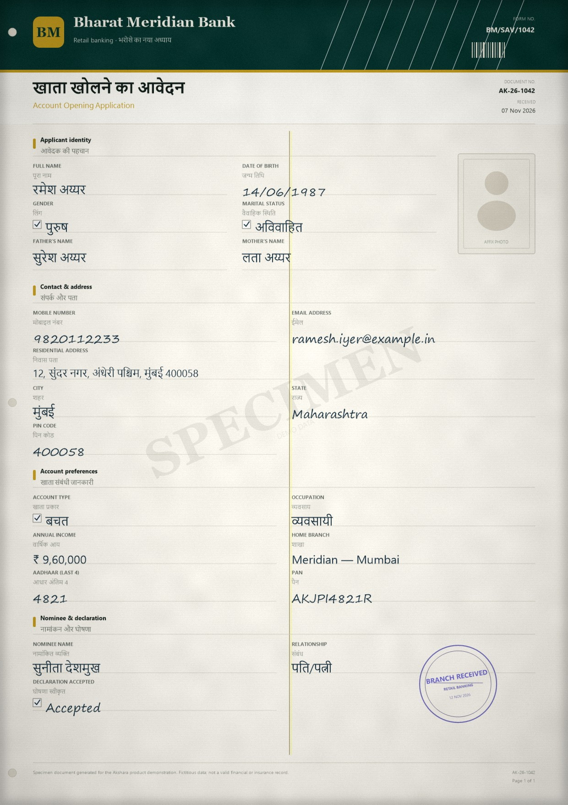

# Akshara

**Document intelligence for every script — with a human in the loop.**

Akshara is a runnable prototype for banks, insurers, service centres and businesses that receive scanned forms in regional scripts, mixed languages and inconsistent layouts. It turns a scan into a structured record, shows **field-level confidence**, grounds every field to its **source box on the page**, and routes uncertain work through a real review workflow with corrections, rescan requests, escalation, supervisor overrides and an append-only audit trail.

The demo ships with **18 rendered specimen scans** across six document families, six languages and five writing systems (Latin, Devanagari, Tamil, Bengali, Arabic), including right-to-left layouts.



---

## Quick start

Requirements: **Python 3.10+**. No Python packages are required — the app uses only the standard library and SQLite. The bundled specimen images are already generated.

Optional, for real uploads: **Tesseract 5** installed at the standard Windows path (auto-detected) and **Windows** for PDF rasterisation. Without them, uploads fall back to an explicit manual-indexing task; the specimen library still works.

### Windows

The simplest launcher bypasses the machine execution policy for this one script:

```bat
run.cmd
```

Or run PowerShell explicitly:

```powershell
powershell -NoProfile -ExecutionPolicy Bypass -File .\run.ps1
```

Then open **http://127.0.0.1:8765**.

If you need to rebuild the workspace from scratch:

```powershell
powershell -NoProfile -ExecutionPolicy Bypass -File .\run.ps1 -Reset
```

If your machine allows local scripts, `.\run.ps1` works directly too.

### macOS / Linux

```bash
python3 -m akshara.server --port 8765
```

### Demo accounts

| Person | Email | Password | Role |
|---|---|---|---|
| Maya Rao | `maya@akshara.ai` | `review123` | Reviewer |
| Arjun Mehta | `arjun@akshara.ai` | `super123` | Supervisor |
| Leela Nair | `leela@akshara.ai` | `admin123` | Administrator |

The sign-in screen also has one-click demo buttons.

---

## A five-minute walkthrough

1. **Sign in as Maya.** The overview shows the live queue, SLA risk, confidence distribution, script coverage and recent decisions.
2. Open **Review queue** and choose **AK-26-1042** (a Hindi/English account-opening form, fair scan quality).
3. **Claim** the document. The right-hand pane shows fields grouped by section, with low-confidence and validation-failing fields highlighted. Toggle **all field boxes** or the **confidence heatmap** on the scan.
4. Correct the **date of birth** (`14/O6/1987` → `14/06/1987`) or the mobile number. Every correction is grounded to the field's source box and written to the audit trail.
5. Try **Approve & next**. Maya cannot approve while blocking validation errors remain. The document must be escalated or a supervisor must override.
6. Sign out (bottom of the sidebar), sign in as **Arjun**, open the same document, and use **Override & approve** with a written reason. The override is recorded separately from the approval.
7. Open **Audit log** to see receipt, extraction, routing, claim, corrections, escalation and approval as one attributable timeline.
8. Use **New intake** to process another specimen through an animated pipeline, or upload a **PNG/JPEG/PDF**. Uploads are read **locally by Tesseract** when it is available: word boxes and confidence are real, labels are mapped to the chosen schema, and imperfect results are routed to review. Multi-page PDFs are rasterised with the built-in Windows PDF renderer (up to 6 pages). If Tesseract is unavailable, the app falls back to an explicit **manual-indexing** task rather than pretending an extraction happened.
9. Open **Settings** to adjust the auto-approval threshold, high-value/4-eyes threshold and SLA policy; the changes are audited and apply to new intakes.

---

## What is in the product

### Intake and extraction
- Image intake (PNG/JPEG), multi-page PDF intake and bundled specimen scans.
- **Multi-page PDF intake**: the built-in `Windows.Data.Pdf` renderer rasterises up to 6 pages locally, and the review workspace pages through them with per-page overlays.
- **Real local OCR on uploads**: Tesseract 5.5 is auto-detected, word boxes and per-word confidence are parsed from TSV, and a label-anchored extractor maps values into the selected schema. The raw OCR text is available in a dedicated review tab.
- **Script-aware specimen fixtures** for the 18 demo scans with exact field boxes, including right-to-left Arabic.
- A provider boundary designed for a production OCR/VLM (see [Architecture](docs/ARCHITECTURE.md)). The local Tesseract adapter is the working baseline; Azure DI is recognized when credentials are present.

### Confidence and validation
- Field-level confidence chips, confidence bands and a document-level aggregate.
- Scan overlay with **issues-only**, **all fields** and **heatmap** modes.
- Deterministic validation: required fields, dates, phone/PIN/PAN/IFSC/GSTIN formats, invoice arithmetic, claim date order and sum-insured ceilings.
- Blocking vs. warning severities; source-of-truth validation is independent of the model.

### Human review
- Risk-ranked queue with SLA timers, unassigned work, low-confidence and validation filters.
- Claim / release, inline field correction, verify all high-confidence fields, approve, reject, request rescan, escalate, reopen.
- Supervisor-only overrides with a written reason; high-value four-eyes policy.
- Notes, comments and an immutable event timeline.
- Keyboard shortcuts (`J`/`K`, `Enter`, `Esc`, `A`, `R`, `?`).

### Operations
- Overview with volume/STP trend, queue health, workload and attention list.
- Analytics: automation by type and language, confidence calibration, error hotspots, reviewer throughput, SLA compliance.
- Audit log with filters and pagination.
- Settings for thresholds, high-value routing, SLA, languages and providers.
- Role-aware UI: reviewer, supervisor and administrator.

---

## Architecture at a glance

```
Scan ──► intake ──► preprocess ──► script/layout analysis ──► OCR / VLM
                                                               │
                                                               ▼
                         field mapping ◄── schema + validation rules
                               │
                               ▼
                 field confidence + calibration
                               │
             ┌─────────────────┴──────────────────┐
             ▼                                    ▼
      auto-approval                      human review queue
      (threshold +                        (claim → correct → approve /
       validations)                        rescan / reject / escalate)
             └─────────────────┬──────────────────┘
                               ▼
                     audit trail + export
```

The runtime is deliberately small:

- `akshara/server.py` — dependency-free HTTP API and static SPA server.
- `akshara/db.py` — SQLite schema, seed data, read models and workflow mutations.
- `akshara/validators.py` — deterministic field and cross-field rules.
- `akshara/auth.py` — PBKDF2 passwords, signed HttpOnly sessions, CSRF tokens.
- `web/` — hand-built HTML/CSS/ES-module SPA (no build step).
- `data/samples/` — rendered specimen images + extraction fixtures.
- `tools/` — specimen generator (Python + a small GDI+ renderer), screenshot helper, sample data.

See **[docs/ARCHITECTURE.md](docs/ARCHITECTURE.md)** for the pipeline, confidence aggregation, provider adapter contract, state machine, data model and production hardening.

---

## The specimen library

The 18 scans are generated offline from HTML-like layouts and rendered with GDI+ (which handles Devanagari, Tamil, Bengali and Arabic shaping on Windows). They include:

- Deformed/creased paper, grain, vignettes, JPEG generation loss and a red branch stamp.
- Bilingual labels, mixed-script values and RTL fields.
- Deliberate OCR-style errors: `14/O6/1987`, `982O112233`, a total that is ₹10,000 higher than subtotal + tax, a discharge date before admission, an unreadable ID number.
- Quality tiers (`good`, `fair`, `poor`) that drive confidence and routing.

To rebuild the images and fixtures:

```powershell
python tools\generate_samples.py
```

This requires Pillow and NumPy (available in the DSH bundled runtime). The application itself does **not** need them at runtime. The generator uses Windows PowerShell + `System.Drawing`; see `tools/render.ps1`.

> All names, companies, account numbers, policies and amounts are fictitious. Every specimen is marked **SPECIMEN / DEMO DATA**.

---

## Tests

```powershell
python -m unittest discover -s tests -v
```

Covers validation formats, claim date ordering, invoice arithmetic, the blocked-approval/override path, field corrections, manual uploads, reopen semantics, analytics, audit, TSV parsing, label extraction, real English OCR, OCR ingest with source boxes, two-page PDF rasterisation and multi-page persistence.

The frontend has no build step. Syntax-check the ES modules with:

```powershell
node --check web\assets\js\app.js
```

---

## Configuration

Environment variables read by the Settings provider panel:

| Variable | Purpose |
|---|---|
| `AZURE_DOC_INTELLIGENCE_ENDPOINT` | Azure Document Intelligence endpoint |
| `AZURE_DOC_INTELLIGENCE_KEY` | Azure DI key |
| `TESSERACT_CMD` | Optional path to a local Tesseract binary |

Tesseract is detected from `TESSERACT_CMD`, `PATH`, or the standard Windows install path (`C:\Program Files\Tesseract-OCR\tesseract.exe`). The current install has `eng` and `osd` language data; uploads are OCR'd in English and then reviewed. To extend regional uploads, add the relevant `*.traineddata` files to Tesseract's `tessdata` directory (for example `hin`, `mar`, `tam`, `ben`, `ara`) and restart the app.

PDFs are rasterised locally through `Windows.Data.Pdf` (`tools/pdf_render.ps1`); no cloud service is involved. The app processes up to six pages per PDF.

The bundled specimen flows use the deterministic fixture adapter so the regional-script demo remains reproducible. Cloud providers are shown as **configured / needs credentials** but are not called by the demo flows; wiring an adapter is described in the architecture note.

---

## Security and production notes

This is a product prototype, not a production system. It already includes password hashing, signed HttpOnly cookies, CSRF checks, same-origin CSP, parameterized SQL, upload type checks and role-gated actions. Before handling real financial or health data you would also need:

- SSO/SAML/OIDC, MFA and fine-grained RBAC/ABAC.
- Encryption at rest and in transit, key management, tenancy isolation and data residency.
- Virus scanning, DLP, retention/erasure policy and PII minimisation.
- A production OCR/VLM tier with calibrated confidence per script/engine, regional language packs, handwriting evaluation and drift monitoring. Tesseract is a working local baseline, not a final accuracy benchmark.
- Queue SLAs, four-eyes policies, maker-checker controls and regulator-grade audit retention.
- DPDP Act 2023 / RBI outsourcing / insurance regulatory reviews as applicable.
- Page splitting/linking beyond the first six PDF pages; every rendered page can be reviewed, but a document is capped at six pages.
- OCR language packs for Hindi, Marathi, Tamil, Bengali and Arabic. The demo has real English OCR; the regional specimen library remains fixture-backed, which is clearly surfaced in the UI's OCR tab.

The code and sample data are provided as an illustrative prototype. Do not use the demo credentials or data in production.

---

## License / provenance

Built as a self-contained prototype. All specimen content is synthetic. Fonts used in the rendered scans are Windows system fonts; no font files are redistributed.

This project is licensed under the MIT License. See [LICENSE](LICENSE) for details.


