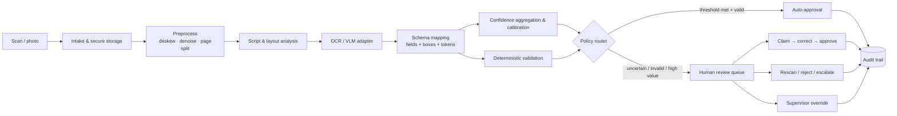
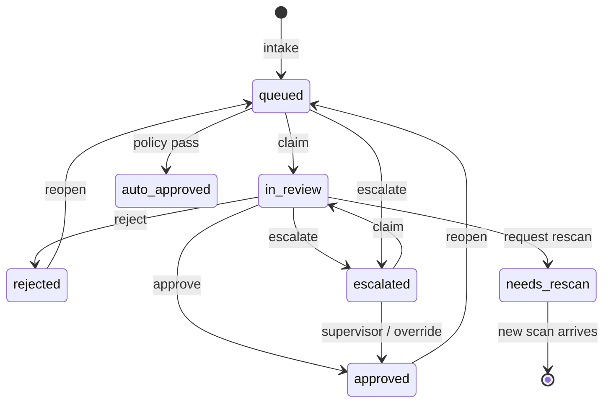

# Architecture

Akshara is a confidence-aware document intake prototype. It is intentionally split into a deterministic application core and an extraction adapter boundary. The review workflow, validation, audit trail and policy controls do not depend on which OCR/VLM vendor produced the fields.

---

## 1. System shape



The prototype runs entirely locally:

| Layer | Implementation |
|---|---|
| HTTP + static | `http.server.ThreadingHTTPServer` |
| Persistence | SQLite (WAL) |
| Extraction | Tesseract 5 local OCR for uploads + fixture adapter for specimens |
| PDF pages | Windows.Data.Pdf local rasteriser (up to 6 pages) |
| Review UI | Vanilla ES modules, no build step |
| Auth | PBKDF2-SHA256, signed HttpOnly cookie, per-session CSRF |
| Specimen generation | Python layout DSL → GDI+ renderer → Pillow scan effects |

There are no runtime pip/npm dependencies. Tesseract and the Windows PDF renderer are optional local binaries/APIs used when present. This is a deliberate constraint for a portable demo; a production deployment would add FastAPI/Postgres/Redis or an equivalent stack behind the same domain boundaries.

---

## 2. Pipeline

### 2.1 Intake
- Accepts PNG/JPEG images and PDFs up to 15 MB, or a bundled specimen.
- Images are magic-byte checked and dimension-parsed. PDFs are loaded through the built-in `Windows.Data.Pdf` renderer and each page is rasterised to PNG (up to six pages), then OCR'd independently. All uploads and page files are stored under `data/uploads/`.
- A document is created with `submitted_at`, an SLA due date, a priority and a source.
- If Tesseract is installed, an upload is OCR'd locally and mapped into the selected schema; the raw OCR text and provider metadata are stored with the document.
- If Tesseract is absent or unreadable, the upload becomes a **manual-indexing** task with a field schema but no values. This is an explicit, honest fallback rather than pretending an OCR result exists.

### 2.2 Preprocess
A production pipeline would deskew, denoise, detect page boundaries, split multi-page PDFs and estimate image quality. The demo bakes scan artefacts (grain, vignette, JPEG loss, fold lines, stamps) into the specimen images so that quality tiers and confidence are visible during review.

### 2.3 Script and layout
- Document family determines the field schema (bank account, health claim, service request, loan, invoice, KYC).
- The specimen fixtures carry a primary language, script and field boxes that were measured during rendering.
- RTL Arabic fields are rendered right-aligned; the UI respects `dir` for values.

### 2.4 Extraction

**Uploads — local Tesseract.** The adapter runs `tesseract <image> stdout -l <lang> --psm 11 tsv`, parses word-level boxes and confidence, groups words into lines, and locates each schema label. Values are read from the same line or from the line immediately below the label in the same column. The chosen words become field values with their union box and a confidence blend (`0.65 * mean + 0.35 * min`). Low-confidence results are kept, not silently dropped: the reviewer sees the box and the score and can correct or reject. A sparse-text page segmentation mode (11) is used because real bank forms often have small, separated labels that a dense paragraph model misses.

**Specimens — fixture adapter.** It returns per-field:
- OCR value (which may contain an error),
- ground-truth value (used only for fixture generation/tests),
- field label, section, type, options, required flag,
- bounding box in page coordinates,
- confidence.

A production adapter returns the same shape. See §5. The label-anchored extractor is a baseline, not a layout model: it is intentionally transparent and debuggable, and its raw OCR output is exposed in the review UI so a reviewer can see exactly what the engine read.

### 2.5 Confidence
Field confidence is derived from token confidence. A robust aggregation should not average away one bad token:

```
field_confidence =
    0.55 * min(token_confidence)
  + 0.35 * mean(token_confidence)
  + 0.10 * calibration_score(field_type, script, engine)
```

The fixture adapter pre-computes field scores using a min/mean blend. The document score is:

```
document_confidence = 0.55 * min(field_confidence)
                    + 0.45 * mean(field_confidence)
```

In production, calibration would be empirical: bucket scores by field type/script/engine, measure observed accuracy on a labelled holdout set, and fit isotonic regression or Platt scaling. The UI intentionally exposes the **field** score, not just the page score, because the page score hides the one field that matters.

### 2.6 Validation
Validation is deterministic and separate from the model:

- required fields,
- date parsing and future/DOB bounds,
- mobile, PIN, PAN, IFSC, GSTIN, account and email formats,
- claim discharge ≥ admission,
- claim ≤ sum insured,
- invoice subtotal + CGST + SGST = total,
- loan affordability warning,
- service preferred-date warning.

Each issue has a severity (`valid`, `warning`, `invalid`) and a blocking flag. Approval is blocked by invalid required fields unless a supervisor records an override. This is intentionally a policy decision, not a model decision.

### 2.7 Routing
The router uses:
- document confidence and per-field scores,
- blocking validation count,
- high-value flag,
- scan quality,
- priority and SLA.

If all fields are above the auto-approval threshold, validation is clean, and high-value policy permits it, the document is auto-approved. Otherwise it is queued with a human-readable reason.

---

## 3. Review state machine



`needs_rescan` is a paused state in the demo; a production system would link the original document to a replacement scan while retaining history.

### Ownership
- A reviewer must **claim** an unassigned document before editing or approving it.
- Supervisors/admins can work on any open document.
- A reviewer cannot edit a document assigned to someone else.
- High-value approvals require a supervisor when policy says so.
- Reopening is supervisor/admin only and resets verification while preserving corrections.

### Audit
Every state change and field edit inserts an event:
`document.received`, `document.extracted`, `document.routed`, `document.auto_approved`, `document.claimed`, `document.released`, `field.corrected`, `field.bulk_verified`, `document.approved`, `document.rejected`, `document.rescan`, `document.escalated`, `document.override`, `document.reopened`, `comment.added`, `settings.updated`.

Events carry actor, timestamp, detail and structured meta (old/new value, reason, blocking issues). The table is append-only in the application; production would add database grants/WORM storage and retention policy.

---

## 4. Data model

```
users(id, name, email, role, title, password_hash, initials, color)
documents(id, ref, doc_type, title, customer_name, language, script, status,
          priority, confidence, quality, image_file, submitted_at, due_at,
          claimed_at, assignee_id, reviewer_id, reviewed_at, amount,
          is_high_value, engine, notes, counts...)
fields(id, document_id, key, label, section, value, original_value,
       confidence, page, x, y, w, h, type, required, options, dir,
       validation_status, validation_message, corrected, corrected_by,
       corrected_at, verified)
events(id, document_id, user_id, action, detail, meta, created_at)
comments(id, document_id, user_id, body, created_at, resolved)
metrics_daily(day, volume, auto_approved, reviewed, corrections,
              avg_confidence, avg_tat_minutes)
settings(key, value)
```

Key points:
- `original_value` is preserved separately from the current `value`, so a correction shows a before/after diff.
- `x/y/w/h` are page-pixel coordinates at the original scan resolution; the UI scales them by percentage.
- `verified` means a human confirmed the field; `corrected` means the value changed from the model output.
- Counts (`low_count`, `invalid_count`, `verified_count`, `corrected_count`) are denormalised for the queue list and recalculated on field edits.

---

## 5. Provider adapter contract

A production adapter should implement:

```python
from dataclasses import dataclass

@dataclass
class ExtractedField:
    key: str
    label: str
    value: str
    confidence: float          # 0..1, calibrated
    bbox: tuple[float, float, float, float]
    type: str = "text"         # text/date/amount/phone/...
    required: bool = True
    options: list[str] | None = None
    dir: str = "ltr"

@dataclass
class ExtractionResult:
    fields: list[ExtractedField]
    language: str
    script: str
    engine: str
    engine_version: str
    quality: str               # good/fair/poor/unknown

class ExtractionProvider:
    def extract(self, image_path: str, schema: dict) -> ExtractionResult: ...
```

Recommended production candidates:

| Provider | Fit | Notes |
|---|---|---|
| Azure AI Document Intelligence | Strong layout/key-value; custom models | Calibrate per model/language; bounding polygons |
| Google Document AI / Vertex | Strong OCR, custom extractors | Per-processor confidence |
| AWS Textract | Forms/tables, async jobs | Confidence per word/field |
| PaddleOCR | On-prem Indic/Arabic recognition | Pair with a layout model and field mapper |
| Tesseract 5 | Cheap baseline | Weak on handwriting; per-word confidence |
| A VLM (e.g. Qwen-VL, GPT-4o-class) | Handwriting/mixed layouts | Use constrained JSON schema; never trust confidence blindly; cross-check with deterministic rules |

The review contract should remain unchanged: normalized fields, boxes, confidence, validation issues, actor-attributed events.

---

## 6. Security and compliance posture

Implemented in the prototype:
- PBKDF2-SHA256 password hashes (180k rounds).
- HMAC-signed session cookies (`HttpOnly`, `SameSite=Lax`, 12h expiry).
- Per-session CSRF token required for mutating requests.
- Parameterized SQL; no string-built queries with user input.
- CSP, `X-Frame-Options: DENY`, `nosniff`, same-origin `connect-src`.
- Upload magic-byte checks and a 15 MB limit.
- Role checks on claims, edits, approvals, escalation, reopen, settings and reset.
- Append-only audit semantics in the application layer.

Production additions:
- SSO/OIDC/SAML, MFA, SCIM, fine-grained RBAC/ABAC.
- Tenant isolation, field-level encryption, KMS, data residency.
- Malware scanning and DLP on uploads.
- PII minimisation, retention/erasure, consent records.
- WORM audit storage, time synchronisation, export controls.
- Model monitoring: calibration drift, language/script performance, correction-rate alerts.
- Four-eyes/maker-checker controls beyond the demo's high-value rule.
- DPDP Act 2023, RBI outsourcing, IRDAI and applicable sectoral reviews.

---

## 7. Failure and edge cases handled

- Invalid/expired session → UI returns to sign-in.
- CSRF mismatch → 403 with a clear error.
- Stale HTTP body after a no-payload action → consumed server-side to keep keep-alive framing correct.
- Claiming a closed or already-assigned document → 409, with a human-readable message.
- Approving with blocking issues as a reviewer → 409 with structured issues.
- Approving a high-value document as a reviewer → 403 `supervisor_required`.
- Supervisor override → requires a written reason; recorded as both `document.approved` and `document.override`.
- Editing a closed document → locked until reopened.
- Reopening → clears verification, preserves corrections and prior events.
- Upload with a low-quality image or unsupported script → local OCR result (low confidence) or explicit manual-indexing fallback; neither is silently auto-approved.
- Upload when Tesseract is unavailable → explicit manual-indexing task, not a fake extraction.
- Upload of a non-image → 415.
- Unknown document/sample/field → 404.
- Empty settings update → 400; review threshold must stay below auto-approval threshold.

---

## 8. Deliberate prototype limits

- PDF documents are capped at six rendered pages; there is no page splitting, page-level classification or automatic linking of a replacement scan.
- The 18 regional specimen flows are fixture-backed and deterministic; live uploads use local Tesseract English OCR. Regional Tesseract language packs (Hindi, Marathi, Tamil, Bengali, Arabic) are not installed in this environment, so those uploads currently fall back to English OCR or manual indexing.
- The label-anchored extractor handles simple label-above-value forms; dense multi-column tables, handwriting and arbitrary layouts still need a layout model or a human.
- No email/SMS/queue integrations; SLA timers are local.
- No real tenant isolation or SSO.
- Analytics are computed over the seeded snapshot plus historical metrics, not a data warehouse.
- The demo password is intentionally visible; do not reuse it.

